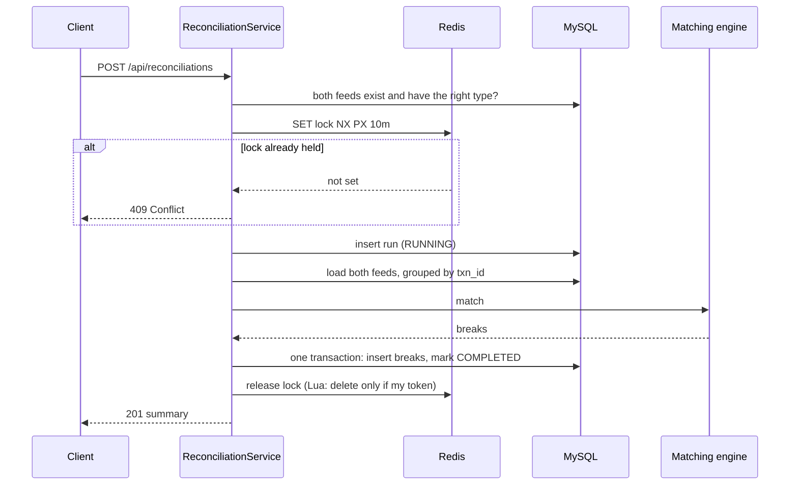
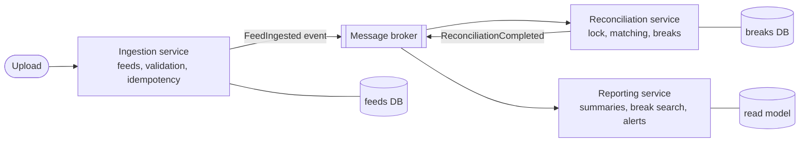

# Recon

Recon is a transaction reconciliation service. It takes an exchange's internal ledger and an external statement, such as one from a bank or custodian, compares them transaction by transaction, and reports every difference as a *break*.

Built with Java 21, Spring Boot 3.5, MySQL 8, Redis, Flyway, JUnit 5, Testcontainers, Docker Compose and GitHub Actions.

## Contents

- [Quick start](#quick-start)
- [API](#api)
- [Architecture](#architecture)
- [How a reconciliation works](#how-a-reconciliation-works)
- [Design decisions](#design-decisions)
- [Performance](#performance)
- [Testing](#testing)
- [Configuration](#configuration)
- [Known limitations](#known-limitations)
- [How the service could be split later](#how-the-service-could-be-split-later)

## Quick start

You need JDK 21 and Docker Desktop. Gradle downloads JDK 21 through its toolchain if your default Java is older.

```bash
docker compose up -d --wait
./gradlew bootRun
```

`bootRun` uses the `local` profile, which holds the throwaway database credentials from `compose.yaml`. When the app is started any other way, it has no credential defaults and expects `DB_USERNAME` and `DB_PASSWORD`.

Then, in a second terminal:

```bash
URL=http://localhost:8080/api
curl -i -F file=@samples/ledger.csv $URL/feeds/ledger
curl -i -F file=@samples/external.csv $URL/feeds/external
curl -i -H 'Content-Type: application/json' \
  -d '{"ledgerFeedId":1,"externalFeedId":2}' $URL/reconciliations
curl $URL/reconciliations/1
curl "$URL/reconciliations/1/breaks?type=AMOUNT_MISMATCH"
```

Swagger UI is at http://localhost:8080/swagger-ui.html, and health is at http://localhost:8080/actuator/health.

## API

| Method | Path | What it does |
|---|---|---|
| POST | `/api/feeds/ledger` | Upload the internal ledger CSV (multipart field `file`) |
| POST | `/api/feeds/external` | Upload the external statement CSV |
| GET | `/api/feeds/{id}` | Feed summary: accepted and rejected row counts |
| GET | `/api/feeds/{id}/errors` | Rejected rows with the reason, paginated |
| POST | `/api/reconciliations` | Compare a ledger feed with an external feed |
| GET | `/api/reconciliations/{id}` | Status, duration and break counts per type |
| GET | `/api/reconciliations/{id}/breaks` | Breaks, paginated and filterable by `type` |

CSV columns, in this order: `txn_id,account_id,asset,amount,status,timestamp`. Status is `PENDING`, `SETTLED` or `FAILED`. Timestamps are ISO-8601 with an offset.

Status codes:

- **Uploads:** a new file returns 201. The same file again returns the original feed with 200. A file that can't be read returns 400 and stores nothing.
- **Reconciliations:** a second run on the same feeds while one is in progress returns 409. If Redis is down, a run returns 503.

Every error uses one JSON format:

```json
{"timestamp":"2026-11-08T06:00:00Z","status":409,"error":"Conflict","message":"A reconciliation of feeds 1 and 2 is already running","path":"/api/reconciliations"}
```

### Break types

| Type | Meaning |
|---|---|
| `MISSING_EXTERNAL` | In the ledger, not in the external statement |
| `MISSING_INTERNAL` | In the external statement, not in the ledger |
| `AMOUNT_MISMATCH` | Same `txn_id`, different amount (`1.50` equals `1.5`) |
| `STATUS_MISMATCH` | Same `txn_id`, different status |
| `ASSET_MISMATCH` | Same `txn_id`, different asset |
| `ACCOUNT_MISMATCH` | Same `txn_id`, different account |
| `DUPLICATE` | A `txn_id` appears more than once in one feed |

One transaction can have several breaks. For example, a wrong amount and a wrong status are reported separately, so each can be fixed and counted on its own.

## Architecture

One Spring Boot service, split by feature (`feed`, `reconciliation`, `common`). Each feature has controller, service and repository layers, and its DTOs are kept separate from its entities.

```mermaid
flowchart LR
    client([Client / Swagger UI])

    subgraph app[Recon service]
        direction TB
        subgraph feed[feed]
            FC[FeedController] --> FS[FeedService]
            FS --> CSV[CsvFeedReader +<br/>TransactionRowValidator]
            FS --> FW[FeedWriter<br/>JDBC batches]
        end
        subgraph recon[reconciliation]
            RC[ReconciliationController] --> RS[ReconciliationService]
            RS --> ME[ParallelMatchingEngine<br/>4 threads, 16 chunks]
            RS --> RW[ReconciliationWriter]
        end
        GEH[GlobalExceptionHandler<br/>one JSON error format]
    end

    subgraph mysql[(MySQL: source of truth)]
        T1[feed<br/>feed_transaction<br/>feed_row_error]
        T2[reconciliation<br/>reconciliation_break]
    end

    subgraph redis[(Redis: speed and safety only)]
        K1[upload fingerprints<br/>24h]
        K2[run lock<br/>SET NX, 10m TTL]
        K3[completed summaries<br/>1h]
    end

    client --> FC
    client --> RC
    FW --> T1
    FS -. "seen this file?" .-> K1
    RS -->|load rows| T1
    RW --> T2
    RS -. lock .-> K2
    RS -. cache .-> K3
```

**MySQL holds the truth, and Redis only makes things faster or safer.** If Redis loses every key, no data is lost. Uploads and reads fall back to MySQL. Only new runs stop, with a 503, because the lock is their only protection against running twice.

The schema is managed by Flyway (`src/main/resources/db/migration`). Applied migrations are never edited, so the asset and account break types arrived in `V2` rather than as a change to `V1`.

## How a reconciliation works



Matching splits transactions into 16 chunks by `floorMod(txn_id.hashCode(), 16)`. A `txn_id` always lands in the same chunk, so both sides of every transaction meet in one place, and the chunks never need to talk to each other. Four threads work through the chunks, and the results are sorted into a fixed order so the output is identical to a single-threaded run.

## Design decisions

| Decision | Why | Trade-off |
|---|---|---|
| Amounts are `BigDecimal`, compared with `compareTo` | `double` can't hold `0.1` exactly, and `equals` says `1.50 ≠ 1.5` | Slower than primitives, which doesn't matter here |
| Bad rows are saved with a reason, not dropped | A reconciliation that silently skips rows hides exactly the problems it exists to find | Rejected rows also show up as `MISSING_*` breaks |
| A broken file is rejected whole, with 400 | If the header is wrong, every row is suspect, and half-loading it is worse than nothing | The sender must fix and resend |
| Uploads are idempotent by SHA-256 of the bytes | Retries and double clicks must not create a second copy of the same file | A re-exported file with identical content but different bytes counts as new |
| Redis is checked first, then MySQL, with `UNIQUE(feed_type, file_hash)` as backstop | Redis is fast but can lose keys, and the constraint is the only check that holds when two uploads race | Two lookups on a miss |
| The fingerprint is written to Redis only after the DB commit | Otherwise a rolled-back upload could leave a key pointing at nothing | A crash between commit and Redis write just means a slower next lookup |
| Rows are written with `JdbcTemplate` batches; JPA is used for the rest | Hibernate turns off batching for `IDENTITY` keys, and per-row inserts were far slower | Two persistence styles in one codebase |
| Matching uses chunks partitioned by `txn_id` hash, plus a fixed thread pool | No locks are needed inside matching, and a test checks the result equals the single-threaded engine | Speedup is capped because loading from MySQL is most of the time (Amdahl's law) |
| More chunks (16) than threads (4) | A thread that finishes early can take more work, which smooths uneven chunks | Slight overhead per chunk |
| Breaks and `COMPLETED` are saved in one transaction | A reader never sees a completed run with half its breaks | A large run holds one long transaction |
| The lock is Redis `SET NX` with a TTL in one command | Two separate steps would leave a gap where a crash creates a lock that never expires | A run longer than the TTL loses its lock |
| The lock is released with a token and a Lua compare-and-delete | A slow run whose lock already expired must not delete the next run's lock | Slightly more code than `DEL` |
| The lock fails closed (503), the cache fails open | Without the lock there is no protection, but without the cache there is only a slower read | Runs stop during a Redis outage |
| Only `COMPLETED` summaries are cached | A completed run never changes, so a correct cache entry can't go stale and needs no invalidation | `RUNNING` reads always go to MySQL |
| Redis timeouts are 2s, down from Lettuce's 60s default | During a real outage, requests hung for a minute. Mocked tests missed this, and a test that stops a real Redis container now catches it | Each call during an outage waits 2s before falling back |
| Credentials have no defaults in `application.yml` | A deployment with a missing secret must fail at startup, not connect with a dev password | Local runs need the `local` profile, which `bootRun` sets |

## Performance

Measured on a MacBook with 546,000 rows per feed, with planted breaks of every type:

| | Time |
|---|---|
| Matching, 1 thread | 339 ms |
| Matching, 4 threads | 183 ms (1.86×) |
| Matching, 8 threads | 140 ms (2.43×) |
| Full run, end to end | about 4.3 s: 86% loading, 9% matching, 6% saving |
| Summary read, from MySQL then from Redis | about 8 ms then about 3 ms |

Most of a run is spent loading rows from MySQL, so more matching threads help less and less. The next improvement would be loading both feeds at the same time, or streaming them.

## Testing

```bash
./gradlew test
```

Docker must be running, because Testcontainers starts a real MySQL and Redis for the integration tests. The suite has 169 tests. The main ones:

- **Planted breaks:** a sample-data generator writes feeds with a known list of planted breaks and decoys that look like breaks but aren't. Tests require every planted break to be found, with nothing extra.
- **Parallel equals single-threaded:** the parallel engine's output is compared with the single-threaded engine's on the same data.
- **Concurrency:** two identical uploads racing, many runs racing for the lock (exactly one wins, the rest get 409), and a lock that expires while its run is still going.
- **Real Redis outage:** a test stops the Redis container mid-test and checks that runs return 503 quickly while uploads and reads keep working.
- **Mutation-style checks:** each important guard, such as `NX`, the TTL, the token check and the status filter on the cache, was deliberately broken during development to confirm a test fails.

To generate larger sample feeds with planted breaks, run `./gradlew generateSamples`. The output goes to `build/samples`.

CI (GitHub Actions) runs the full build and test suite on every push.

## Configuration

| Property | Default | Notes |
|---|---|---|
| `DB_HOST`, `DB_PORT`, `DB_NAME` | `localhost`, `3306`, `recon` | Environment variables |
| `DB_USERNAME`, `DB_PASSWORD` | none | Required unless the `local` profile is active |
| `REDIS_HOST`, `REDIS_PORT` | `localhost`, `6379` | Environment variables |
| `recon.matching.threads` / `chunks` | 4 / 16 | |
| `recon.reconciliation.lock-ttl` | 10m | Must be longer than the slowest run |
| `recon.reconciliation.summary-cache-ttl` | 1h | Safety net only |
| `recon.feed.idempotency-ttl` | 24h | How long Redis remembers an upload |

Uploads are limited to 50 MB.

## Known limitations

- **Lock renewal:** the lock is not renewed. A run longer than 10 minutes could overlap with a new one. Each run writes its own rows, so results are not corrupted, but work is duplicated.
- **Crashes:** a crash mid-run leaves that row as `RUNNING`. The lock frees itself when its TTL expires, but nothing marks the row `FAILED` yet.
- **Memory:** both feeds are loaded into memory. The 546,000-row test used about 1.2 GB of heap. Much bigger feeds would need streaming, or a merge of the two feeds sorted by `txn_id`.
- **Duplicates:** for a duplicate `txn_id`, only the first row is compared with the other side.
- **Timestamps:** timestamps are stored but not compared, because the two sides record time differently. A tolerance window would be the next step.
- **Spring Boot version:** the project uses Spring Boot 3.5.16, the last open-source 3.5 release. Free support ended on June 30, 2026, so a production version should move to a supported 4.x release.

## How the service could be split later

Today it's one service on purpose. One team owns it, the parts share tables, and every network hop would add a new way to fail. The feature packages already mark where the seams are:



1. **Ingestion** would own the `feed`, `feed_transaction` and `feed_row_error` tables, and publish an event when a feed is accepted. It scales with upload volume.
2. **Reconciliation** would get feed data from those events or a bulk export, rather than reading the ingestion tables directly. It could even start a run automatically once both sides of a day have arrived. The same `txn_id` hash used for chunks could become the message partition key, so matching could spread across machines instead of threads.
3. **Reporting** would build a read-optimised copy of breaks for search, dashboards and alerts, without loading the database that matching writes to.

Splitting makes sense when uploads and runs need to scale separately, or when different teams own them. It comes with costs: events can arrive twice or out of order (so every consumer must be idempotent, as uploads are now), and there's no shared transaction across services.
